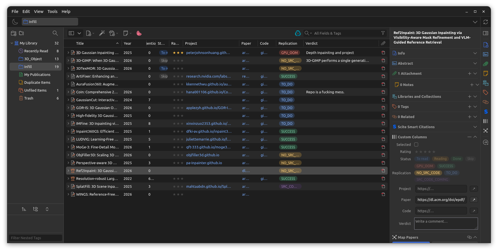
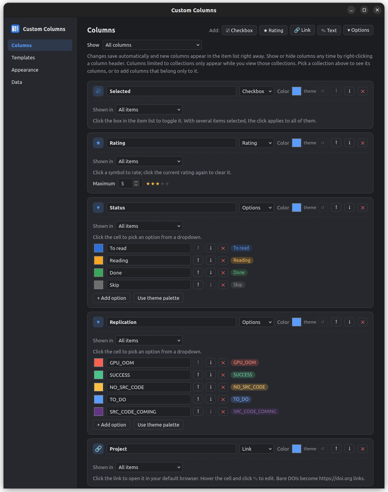
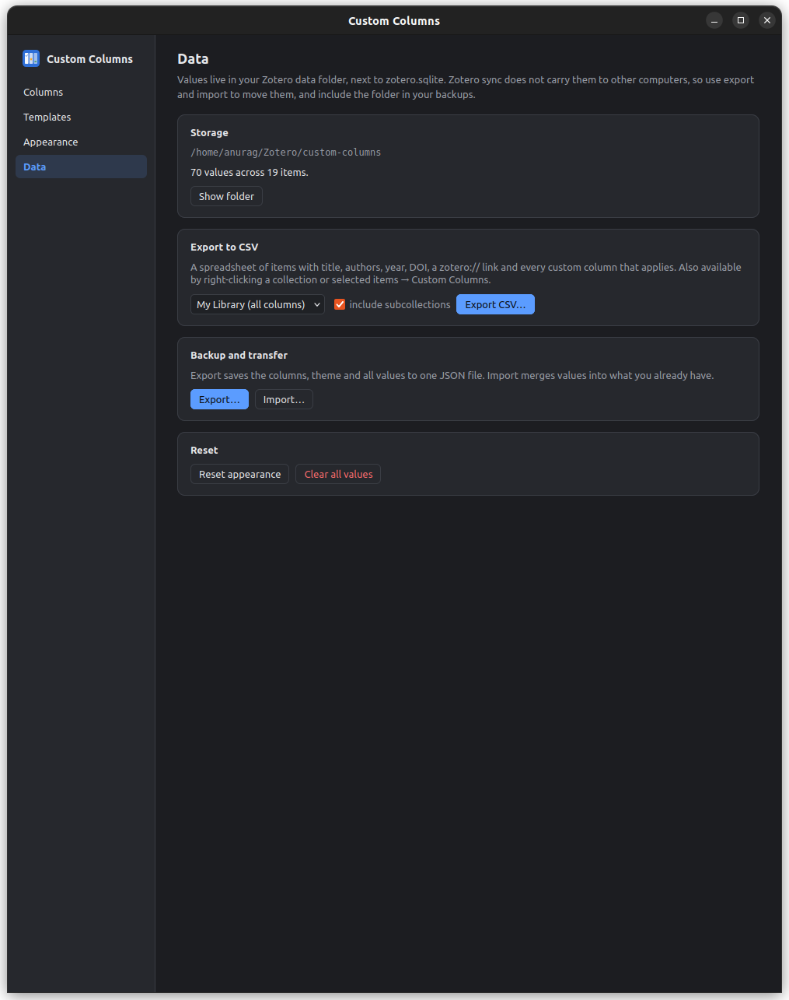

# Custom Columns for Zotero

Add your own columns to Zotero's item list and edit them in place.
Vibecoded using Claude

## Screenshots

[](imgs/img_1.png)
[](imgs/img_2.png)
[](imgs/img_3.png)

| Type | In the item list | Stored as |
|---|---|---|
| **Checkbox** | Click to toggle | `true` |
| **Rating** | Click a star (or ●, ♥, ◆, ▲, ✿). Click the current rating again to clear it | `1`–`max` (max 1–10) |
| **Link** | Click to open in your default browser. Hover and click ✎ to edit | URL (`arxiv.org/…` → `https://…`, bare DOIs → `https://doi.org/…`) |
| **Text** | Hover and click ✎ to open an editor. Good for comments and verdicts | string |
| **Options** | Click to pick from a dropdown of colored options you define | option id |

**Colors and themes:** there are 9 built-in themes (Zotero, Ocean, Sunset, Forest, Nord, Dracula, Solarized, Monochrome, Candy). Each one has a light and a dark palette and follows Zotero's appearance. You can override any theme color separately for light and dark, give each column its own color, and give each option its own color. Option chips come in Soft, Solid or Outline style and Pill, Rounded or Square shape.

**Collection columns:** any column can be limited to specific collections, optionally including their subcollections. It is then added to the item list only while you view one of those collections, and the item pane shows it only for items in them. Right-click a collection → **Custom Columns → Add columns for this collection…**, or set **Shown in** on a column in settings.

**Templates:** ready-made column sets you apply everywhere or to one collection. Each application creates fresh columns, so two collections can have their own "Decision" column with separate values.
- Built-in: *Reading tracker*, *Literature review (screening)*, *Paper writing*, *Course readings*.
- Save your own from existing columns in **Settings → Templates**.
- Apply from Settings → Templates, or right-click a collection → **Custom Columns → Apply template to this collection**.

**CSV export:** gives you title, authors, year, type, publication, DOI, URL, date added, item key, a `zotero://` link, and every custom column that applies. The file is UTF-8 with a BOM, so it opens correctly in Excel, LibreOffice and Google Sheets. Checkboxes export as TRUE/FALSE and options as their labels.
- Right-click a collection (or My Library) → **Custom Columns → Export to CSV…**
- Right-click selected items → **Custom Columns → Export selected items to CSV…**
- Settings → **Data → Export to CSV**, for any collection, with or without subcollections

**Other features**

- **Item pane section:** a "Custom Columns" section in the right pane edits every column for the selected item.
- **Bulk edit:** right-click several items, open **Custom Columns**, and set a checkbox, rating, option, text or link on all of them. Clicking a checkbox, star or option in a row that is part of a multi-selection also applies to the whole selection.
- **Sorting:** click a column header to sort. Options sort in the order you defined them.

## Install

1. Download `build/custom-columns.xpi` (or build it, see below).
2. In Zotero: **Tools → Plugins**, then the gear menu, then **Install Plugin From File…**, then pick the `.xpi`.
3. Columns you create in settings or from templates appear automatically. You can show or hide any column by right-clicking a column header.
4. Configure everything in **Tools → Custom Columns…** (also in Settings → Custom Columns).

Requires Zotero 7 or later. Tested on Zotero 10.0.6 on Linux.

## Where the data lives

Values are stored in `<Zotero data directory>/custom-columns/`:

- `config.json`: column definitions (including collection scopes), your templates, theme and colors
- `values.json`: per-item values, keyed by `libraryID/itemKey`

Zotero sync does **not** carry these files to other computers. To move or back up your data, use **Data → Export…** and **Data → Import…** in the settings window, or copy the folder. Values for deleted items are cleaned up automatically. Items in the trash keep their values.

## Development

Requirements: Node 22 or later, and a Zotero install. There are no npm dependencies.

```bash
npm run build      # syntax check + package → build/custom-columns.xpi
npm run dev        # run Zotero with the plugin loaded live from addon/
npm run smoke      # end-to-end test against a running `npm run dev -- --debug-server`
```

`npm run dev` starts Zotero with a **separate profile and an empty data directory** in `.dev/`, so your real library is never touched. The plugin is loaded straight from `addon/` through a proxy file. After you edit code, quit and re-run `npm run dev`. There is nothing to rebuild.

Options:

```bash
npm run dev -- --debug-server   # allow scripts/rdp.mjs + smoke tests to drive Zotero
npm run dev -- --devtools       # open the Browser Toolbox (inspect DOM/CSS, debugger)
npm run dev -- --all-logs       # don't filter Zotero's debug output
ZOTERO_BIN=/path/to/zotero npm run dev
ZOTERO_DATA_DIR=~/ZoteroCopy npm run dev   # test against a COPY of your library
```

Drive the running dev instance from a terminal:

```bash
node scripts/rdp.mjs eval "return Zotero.CustomColumns.store.config.columns.map(c => c.name)"
node scripts/rdp.mjs screenshot shot.png
```

### Layout

```
addon/                      ← everything inside goes into the .xpi
  manifest.json             plugin id, version, Zotero version range
  bootstrap.js              Zotero plugin lifecycle (startup/shutdown/window hooks)
  locale/en-US/*.ftl        Fluent strings (item pane section header)
  content/
    scripts/themes.js       theme presets + CSS variable generation
    scripts/store.js        config + values persistence (JSON in data dir)
    scripts/scope.js        collection-scoped columns (which columns apply where)
    scripts/templates.js    built-in + user column templates
    scripts/csv.js          CSV export
    scripts/cells.js        column registration + interactive cell rendering
    scripts/editors.js      popup text/link editor and option picker
    scripts/itempane.js     item pane section
    scripts/main.js         init, windows, menus, notifier, settings opener
    styles/cells.css        item list + item pane styling
    settings/               settings window (columns, appearance, data)
    preferences.xhtml       pane in Zotero Settings that opens the window
scripts/
  build.mjs                 zero-dependency .xpi packer (+ update.json)
  check.mjs                 syntax/manifest checks
  dev.mjs                   dev profile + launcher
  rdp.mjs                   DevTools-protocol client (eval / screenshots)
  smoke-test.mjs            end-to-end UI test
```

### Releasing

1. Bump `version` in `package.json`. `npm run build` copies it into `manifest.json`.
2. `npm run build` produces `build/custom-columns-<version>.xpi` and `build/update.json`.
3. For auto-updates, host `update.json` at the `update_url` in `addon/manifest.json`, and the `.xpi` at the `update_link` it contains. Edit `homepage` in `package.json` and `update_url` in the manifest to point at your repository first.
